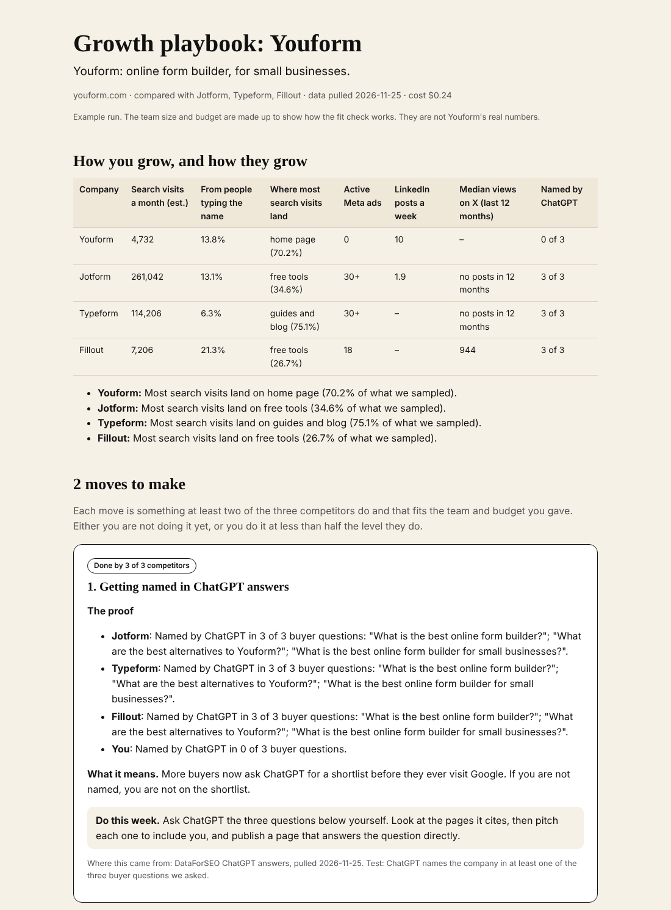

# Growth Playbook Agent

**Paste your website. Get back the growth moves your competitors keep repeating, and only the ones you can actually do.**

It finds your three closest competitors, looks at how each of them gets customers, and keeps only the
moves that at least two of them share. Then it checks each move against your team and budget, and
throws out the ones you can't run. You get one page, with the proof for every move and the bill for
the data.



## See it before you run it

Two finished runs, built from real public data pulled on 25 November 2026:

| Example | What it found | Page |
| --- | --- | --- |
| **Youform**, a small form builder | Jotform, Typeform and Fillout are named in every ChatGPT answer we checked. Youform is named in none. Two of the three get over half their sampled search visits from free tools and templates. | [Open the page](https://htmlpreview.github.io/?https://github.com/assisDevassy/growth-playbook-agent/blob/main/examples/youform/playbook.html) |
| **Tally**, a popular form builder | Tally already does most of what its competitors repeat. The one gap: free tools, where it is far behind Jotform and Fillout. Meta ads were left out because they don't fit the budget in the example. | [Open the page](https://htmlpreview.github.io/?https://github.com/assisDevassy/growth-playbook-agent/blob/main/examples/tally/playbook.html) |

The team size and budget in both examples are made up to show the fit check. They are not the
companies' real numbers. Each run cost $0.24 in data.

## What the page shows

1. **How you grow, and how they grow.** Search visits, how many come from people typing the name,
   where most visits land, Meta ads, LinkedIn and X activity, and whether ChatGPT names each company.
2. **The moves.** Each one shows the proof for every competitor, what it means in plain words, one
   thing to do this week, and where the data came from.
3. **The ChatGPT check.** Three buyer questions, and which companies ChatGPT named, in order.
4. **Moves we left out**, and why: only one competitor does it, or it doesn't fit your team or budget.
5. **The bill.** Every lookup and what it cost.

## How it works

1. You give it your website.
2. You answer four short questions: what you sell, who to, how many people work on growth, and your
   monthly budget.
3. It finds your three closest competitors. It asks ChatGPT three buyer questions and checks which
   sites rank for the same Google searches as you. Companies named by ChatGPT come first.
4. It pulls public data on all four websites: Google search, Meta ads, LinkedIn and X posts.
5. It checks ten known growth moves against every company. A move makes your page only if at least
   two competitors do it, it fits your team and budget, and you either don't do it yet or do it at
   less than half their level.
6. It writes the page, a CSV of the moves and a CSV of the bill.

The moves, their tests and their wording live in [`gpa/moves.json`](gpa/moves.json). Change a
threshold or a sentence and the next run uses your version.

## The moves it looks for

| Move | How it is spotted |
| --- | --- |
| Free tools and templates that catch searches | At least 15% of sampled search visits land on free tool or template pages |
| Public pages your users make, on your domain | At least 3% land on pages customers made with the product |
| Comparison and alternative pages | Three or more comparison pages bring in visits |
| Guides that answer buyer questions | At least 20% land on guides or blog posts |
| A page for every integration | At least 5% land on integration pages |
| Meta ads they keep running | Three or more ads running for 30 days or longer |
| An affiliate program | Affiliate software on the site, or an affiliate page that ranks |
| Growth from attention, not search | Half or more of search visits are people typing the name |
| A steady LinkedIn page | Two or more company posts a week |
| Getting named in ChatGPT answers | Named in at least one of three buyer questions |

## What it costs

About $0.24 a run in the examples. The default spending limit is **$0.50**. Before each paid lookup
it shows the price and asks you to say yes. If a lookup would take the run past the limit, it skips
that lookup and says so on the page. Every answer is saved, so you never pay twice for the same lookup.

## Accounts you need

Two data accounts, both pay-as-you-go. Check each one's pricing page before you sign up.

| Account | What it is used for | What to set |
| --- | --- | --- |
| [DataForSEO](https://dataforseo.com) | Google search data, competitor sites, website details, ChatGPT answers | `DATAFORSEO_LOGIN` and `DATAFORSEO_PASSWORD` (your API login, from their dashboard) |
| [ScrapeCreators](https://scrapecreators.com) | Meta Ad Library ads, LinkedIn company posts, X posts | `SCRAPECREATORS_API_KEY` |

```bash
export DATAFORSEO_LOGIN="you@example.com"
export DATAFORSEO_PASSWORD="your-api-password"
export SCRAPECREATORS_API_KEY="your-key"
```

## Run it

You need Python 3.9 or newer. Nothing else to install.

**With an AI coding agent** (Claude Code or similar), paste:

> Clone https://github.com/assisDevassy/growth-playbook-agent, read AGENT.md, and run it for mysite.com.

**By hand:**

```bash
git clone https://github.com/assisDevassy/growth-playbook-agent
cd growth-playbook-agent
python3 -m gpa ask mysite.com     # one lookup, then four questions
python3 -m gpa run mysite.com     # the full run, with a price check before each lookup
```

Open `runs/mysite-com/playbook.html`.

To rebuild a page from saved data without spending anything:

```bash
python3 -m gpa run tally.so --out examples/tally --answers examples/tally/answers.json --replay
```

Run the tests with `python3 -m unittest discover -s tests`.

## What it can't do

- **Search visits are estimates** from DataForSEO, not anyone's real analytics. The page-type
  shares use each site's top 200 Google keywords, by estimated visits.
- **US data only** for now.
- **Meta ads show the first page of results**, up to 30 ads, so "30+" means at least 30.
- **LinkedIn returns about the last ten company posts**, and no likes or comments. With fewer than
  three posts it does not judge a posting rhythm.
- **Social accounts** come from the website's own links, or from you. It never guesses a handle.
- **ChatGPT answers change** from one run to the next. Three questions is a spot check, not a ranking.
- **Page types are sorted by the words in each URL**, so a few pages land in the wrong bucket.
- **It never posts, sends or spends.** It reads public data and writes a report.

## How the examples were made

The data was pulled on 25 November 2026 from the same DataForSEO and ScrapeCreators endpoints the
code calls, through an API gateway rather than with my own keys. The live-call code is written
against the providers' public docs. If a live call fails for you, please open an issue.

The raw files are trimmed to the fields the agent reads, to keep the repo small. The Youform run
reuses the competitor lookups from the Tally run on the same day, because both picked the same three
competitors. Every number on both pages traces back to a file in that example's `raw/` folder.

## Files

```
gpa/sources.py    every paid lookup, the budget check, and saved answers
gpa/signals.py    turns raw answers into plain facts (shares, counts, dates)
gpa/moves.py      spots the moves, keeps the repeated ones, checks the fit
gpa/moves.json    the moves: tests, thresholds and wording
gpa/run.py        the run, step by step
gpa/page.py       the page, moves.csv, bill.csv
examples/         two finished runs with their raw data
AGENT.md          instructions for an AI coding agent
```

## Who made this

Built by Asi. I build AI agents that do the repeat work in marketing.
Questions or a project in mind: assisdevassy@gmail.com

MIT licensed.
